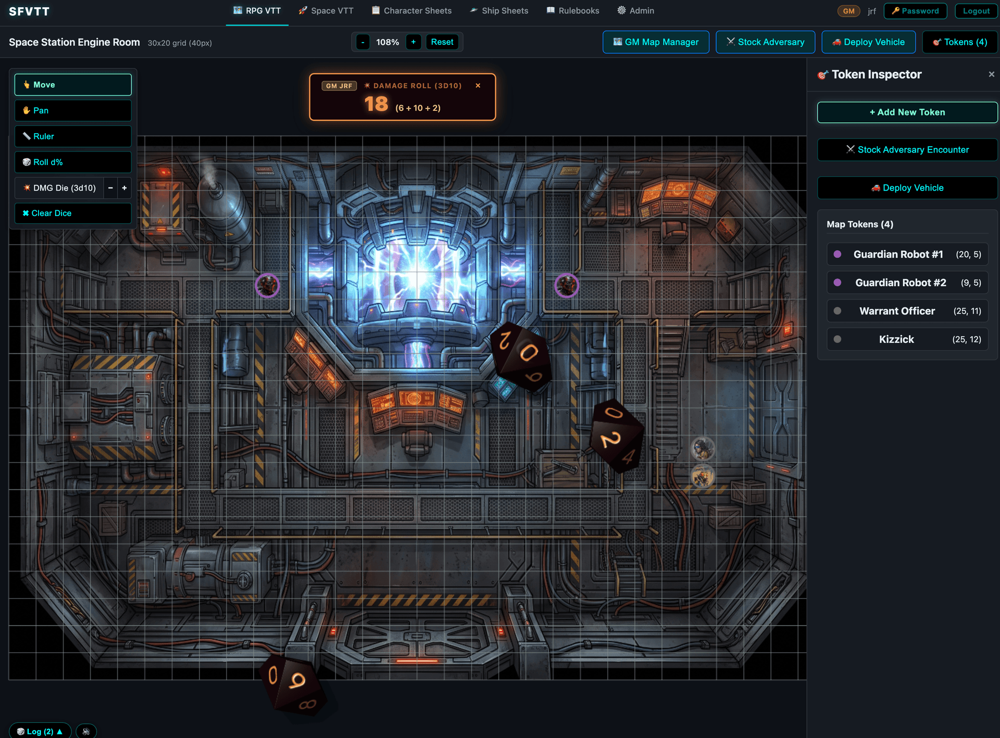
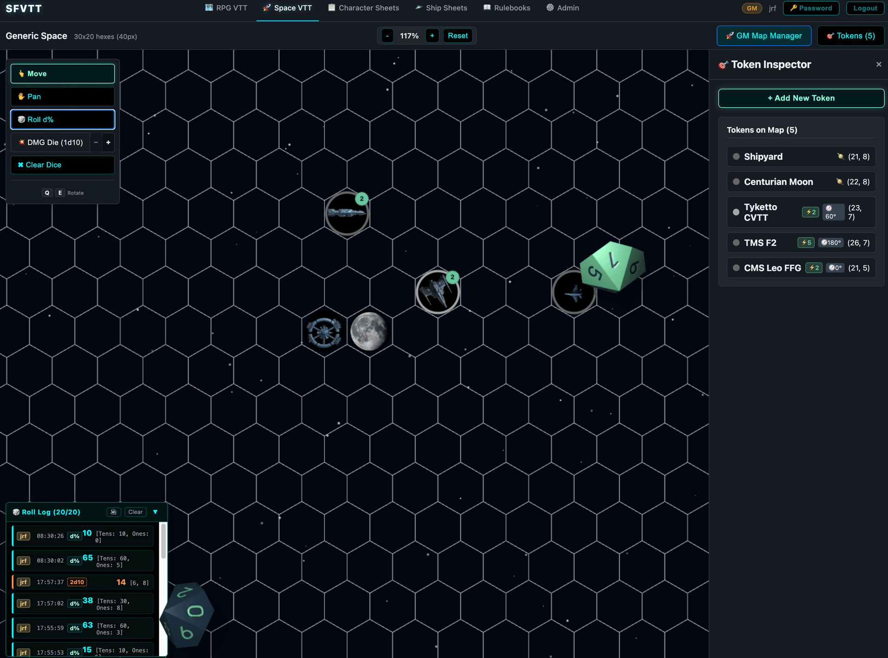
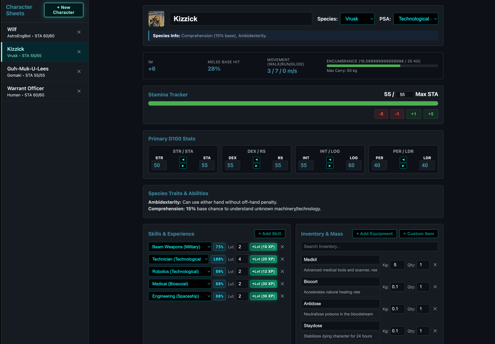
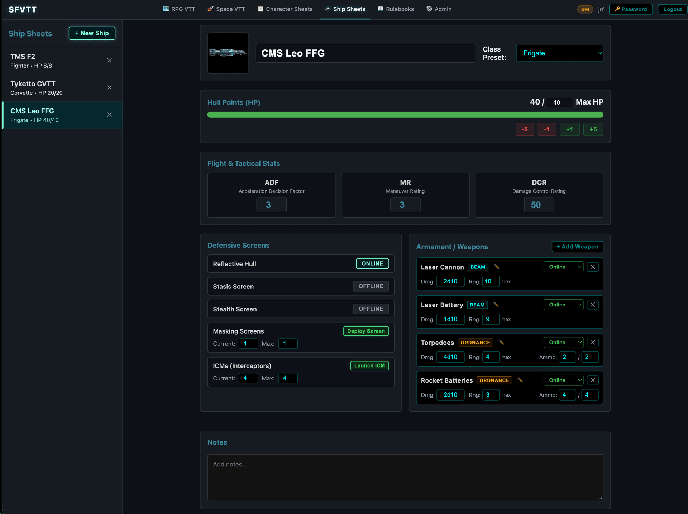
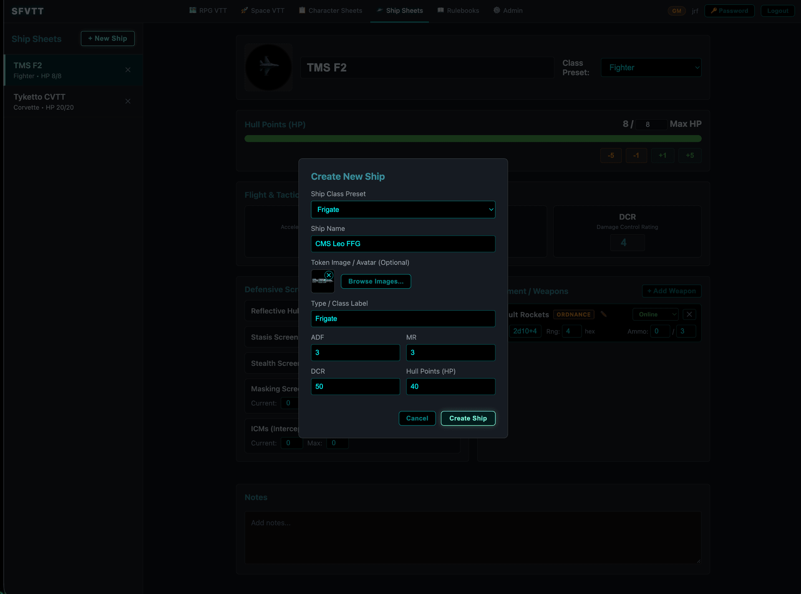
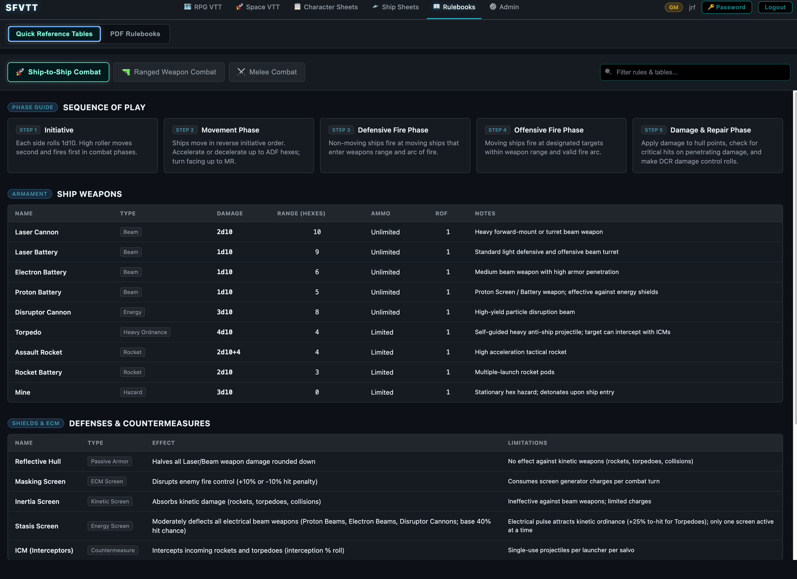
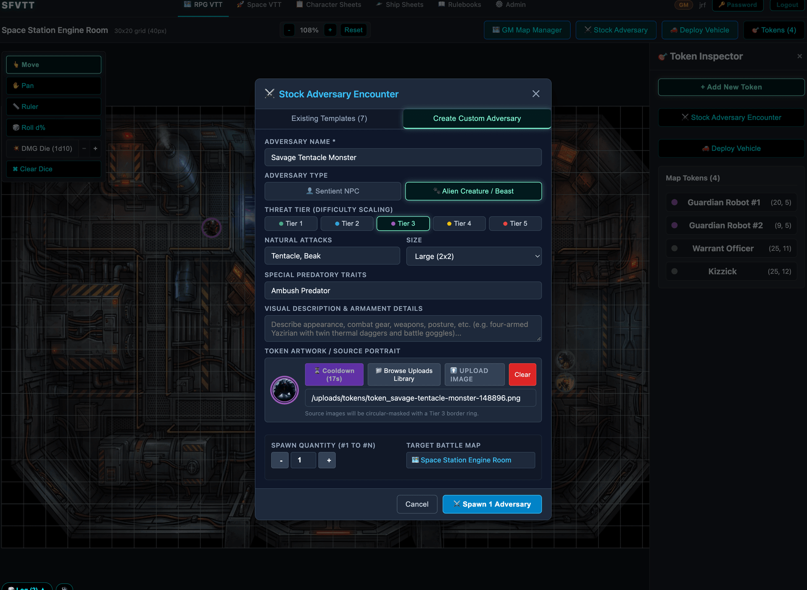
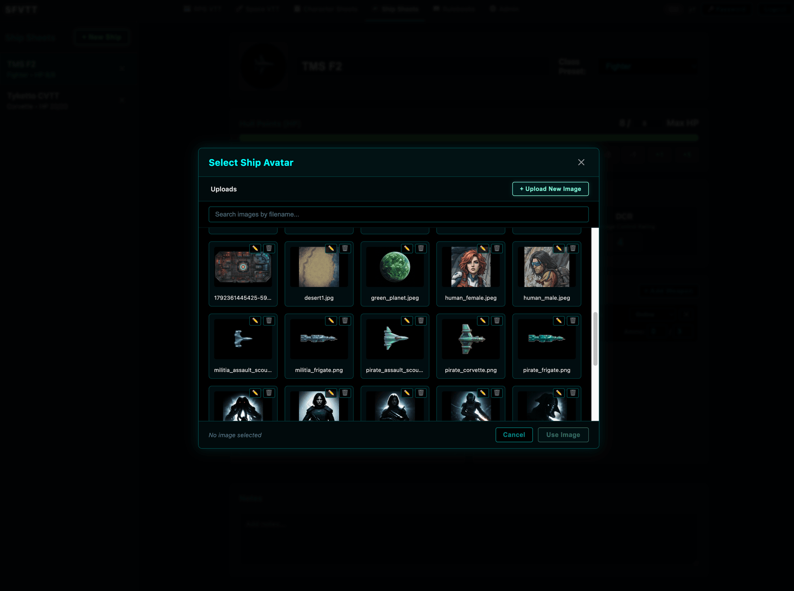

# 🚀 Star Frontiers VTT

A full-stack, real-time multiplayer Virtual Tabletop (VTT) and digital character/starship management platform built specifically for TSR's classic sci-fi tabletop RPG **Star Frontiers** (*Alpha Dawn* and *Knight Hawks*).

---

## 📸 Screenshots & Gallery

### 1. Tactical Battle Maps
| RPG VTT (Alpha Dawn) | Space Combat VTT (Knight Hawks) |
|:---:|:---:|
|  |  |
| *Square-grid tactical canvas with token inspection, vehicle HUDs, and WebGL 3D physics dice.* | *Hex-grid space combat with heading/rotation controls, speed tracking, and celestial bodies.* |

### 2. Digital Sheets & Customization
| Alpha Dawn Character Sheet | Knight Hawks Starship Sheet |
|:---:|:---:|
|  |  |
| *Interactive character sheet with canonical equipment catalog (117 items) and live stat tracking.* | *Full starship management with ADF/MR/DCR ratings, defensive screens, and weapon systems.* |

### 3. Starship Armament & GM Tools
| Equip Ship Weapon Modal | GM Tactical Tools |
|:---:|:---:|
|  |  |
| *Canonical 10-weapon Knight Hawks catalog with limitation badges and custom weapon builder.* | *GM Map Manager, battle map controls, vehicle deployment, and live tokens.* |

### 4. Adversary Encounters & Asset Explorer
| Stock Adversary Generator | Integrated Image Browser |
|:---:|:---:|
|  |  |
| *Procedural NPC/creature stocking with Threat Tier scaling (1–5) and AI circular token art.* | *Visual asset explorer for map backgrounds, token portraits, and custom uploads.* |

---

## ✨ Features

### ⚔️ Dual Tactical Combat Engines
* **Alpha Dawn RPG Grid:** Square tactical grid with customizable grid size, line thickness, and visibility. Supports multi-cell token footprints (1×1, 2×2, 2×3), distance ruler, token snapping, and fog of war.
* **Knight Hawks Space Combat:** Hex-grid battle map featuring tactical ship movement, speed vectors, heading rotation (`Q` / `E` shortcuts for 60° increments), and astronomical celestial tokens (asteroids, moons, planets) layered underneath maneuvering vessels.

### 🎲 3D Physics Dice Roller & Audio
* **Realistic 3D Dice:** WebGL-accelerated 3D dice powered by Babylon.js and Ammo.js physics running directly in the browser.
* **Specialized Roll Types:** Preconfigured for percentile checks (`d%` with tens/ones color distinction) and variable damage dice (`1d10` through `20d10`).
* **Shared Die Roll Log:** Real-time 20-roll history broadcast across all connected players via Socket.io with roller attribution.
* **Synchronized Audio:** Tabletop dice-rolling sound effects with per-user volume validation and mute controls.
* **Instant Dismissal:** Dismiss 3D dice and banner results with `✖ Clear Dice` or the `Escape` key.

### 📋 Interactive Digital Sheets
* **Alpha Dawn Character Sheets:** Complete ability score management (STR, STA, DEX, RS, INT, LOG, PER, LDR), racial abilities for all core species (Human, Dralasite, Vrusk, Yazirian), skill progressions, and an expanded 117-item equipment catalog with category filter tabs.
* **Knight Hawks Starship Sheets:** Tracks Hull Points, Drive speeds (ADF/MR), Damage Control Rating (DCR), defensive screens (Masking, Albedo, Lemmer), ICM interceptors, and combat weapon loadouts with limitation badges (`BEAM` vs `ORDNANCE`).

### 👾 Automated Adversary & Creature Stocking
* **Rulebook-Accurate Procedural Generation:** Instantly stock sentient NPCs (Sathar, pirates, mercenaries) or alien creatures with procedural Threat Tier scaling (Tiers 1–5).
* **AI Token Art Generation:** Built-in generative AI token pipeline featuring circular token masking and color-coded threat tier border rings.
* **Adversary Token HUD:** Live combat action buttons, weapon attacks, damage rolls, and wound tracking directly on the tactical canvas.

### 🚗 Alpha Dawn Tactical Vehicles
* **10 Canonical Vehicles:** Ground Cars, Ground Transports, Hover Cars, Aircars, Explorers, Jetcopters, and more with exact rulebook stats.
* **Custom Vehicle Builder:** Design and persist custom vehicles to the database.
* **Vehicle Token HUD:** Live speedometer (`+ Accel`, `- Decel`, `Emergency Stop`), parabattery energy gauge, and 8 Vehicle Damage Table condition toggles.

### 🗂️ GM Tools & Asset Manager
* **Full Asset Lifecycle:** Upload, organize, rename, and move images into custom subdirectories with atomic cascades across tokens, maps, and character sheets.
* **Real-time Map Switching:** Activate, update, and manage multiple tactical maps independently for RPG and Space modes.

### 📖 Searchable Rulebooks
* Indexed full-text search across official *Alpha Dawn* and *Knight Hawks* rulebooks powered by Lunr.js.

---

## 🛠️ Tech Stack

* **Frontend:** [Vue 3](https://vuejs.org/) (Composition API / `<script setup>`), [Vite](https://vitejs.dev/), [Pinia](https://pinia.vuejs.org/), [Vue Router](https://router.vuejs.org/), [Babylon.js](https://www.babylonjs.com/) & [Ammo.js](https://github.com/kripken/ammo.js/) (3D physics dice), [Lunr.js](https://lunrjs.com/).
* **Backend:** [Node.js](https://nodejs.org/), [Express](https://expressjs.com/), [Socket.io](https://socket.io/) (real-time WebSocket synchronization), [Better-SQLite3](https://github.com/WiseLibs/better-sqlite3), [Sharp](https://sharp.pixelplumbing.com/) (image processing).
* **Testing & Quality:** [Vitest](https://vitest.dev/) (unit & component tests across client and server), [Supertest](https://github.com/ladjs/supertest).
* **Deployment:** [Docker](https://www.docker.com/) & Docker Compose.

---

## 🚀 Quick Start

### Option 1: Docker (Recommended)

1. **Clone the repository:**
   ```bash
   git clone https://github.com/jayrfink/star-frontiers-vtt.git
   cd star-frontiers-vtt
   ```

2. **Start the containers:**
   ```bash
   docker compose up -d
   ```

3. **Open the application:**
   * **Client (VTT):** [http://localhost:3001](http://localhost:3001)
   * **Server API:** [http://localhost:3000](http://localhost:3000)

4. **Initial Setup:**
   * The first user registered through the UI automatically receives the **GameMaster** role. Subsequent registrations default to **Player** unless assigned by the GM.

---

### Option 2: Local Development

1. **Prerequisites:** Node.js (v18+) and npm.

2. **Install dependencies:**
   ```bash
   # Root & shared dependencies
   npm install

   # Client dependencies
   cd client && npm install && cd ..

   # Server dependencies
   cd server && npm install && cd ..
   ```

3. **Run the development servers:**
   ```bash
   # Terminal 1: Backend Server (Port 3000)
   cd server && npm run dev

   # Terminal 2: Frontend Client (Port 3001)
   cd client && npm run dev -- --host
   ```

---

## 🧪 Running Tests

The test suite covers both frontend components and backend REST/Socket APIs:

```bash
# Run server test suite (220+ tests)
cd server && npm test

# Run client test suite (430+ tests)
cd client && npx vitest run
```

---

## 📜 License & Credits

* **Game System:** *Star Frontiers* is a trademark originally published by TSR, Inc. (now Wizards of the Coast). This virtual tabletop is an open-source fan project created to facilitate retro sci-fi tabletop roleplaying games.
* **Codebase:** Distributed under the MIT License.
