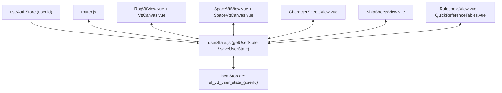

# Design Specification: Per-User Tab and View State Persistence

## Overview
Currently, switching between application tabs (`RPG VTT`, `Space VTT`, `Character Sheets`, `Ship Sheets`, `Rulebooks`) or refreshing the browser resets every view back to its default initial state:
- **RPG VTT & Space VTT**: Canvas `panX` and `panY` reset to `50`, `zoomLevel` resets to `1.0`, `activeTool` resets to `'select'`, `selectedTokenId` resets to `null`, and the Roll Log HUD collapses (`isRollLogOpen = false`).
- **Character Sheets & Ship Sheets**: Navigating away and returning resets `selectedChar` / `selectedShip` to the first item in the list (`characters[0]` / `ships[0]`) and loses list/detail scroll positions.
- **Rulebooks**: Resets `viewMode` to `'quickref'`, `activeCategory` to `'ship'`, `pdfBookId` to `'ad-basic'`, `pdfPage` to `1`, and clears active filters/search queries.
- **Navigation**: Visiting `/dashboard` or logging in always redirects to `/dashboard/rpg-vtt` rather than returning the user to their last active tab.

This specification defines a per-user state persistence architecture scoped by each authenticated user's ID (`authStore.user.id`), preserving and restoring view state across tab transitions, page reloads, and logins.

---

## Requirements & Scope

### 1. Functional Requirements
1. **Per-User Isolation**:
   - All persisted UI state is stored under a user-specific `localStorage` key: `sf_vtt_user_state_${userId}` (where `userId` is `authStore.user?.id`).
   - Multiple users logging in on the same browser maintain completely independent view states.
2. **Last Visited Dashboard Tab**:
   - Navigating to any child route under `/dashboard/...` records that route path as the user's `lastPath`.
   - Navigating to `/dashboard` (including post-login redirect) redirects to the user's saved `lastPath` (falling back to `/dashboard/rpg-vtt` if none exists or if a non-GM user's saved path was `/dashboard/admin`).
3. **RPG VTT & Space VTT State**:
   - Persist and restore independently for `rpgVtt` and `spaceVtt`:
     - `panX` (Number, default `50`)
     - `panY` (Number, default `50`)
     - `zoomLevel` (Number, default `1.0`)
     - `activeTool` (String, default `'select'`)
     - `selectedTokenId` (Number|String|null, default `null`)
     - `isRollLogOpen` (Boolean, default `false`)
   - Expose `panX` and `panY` via two-way `v-model:pan-x` and `v-model:pan-y` bindings on `VttCanvas.vue` and `SpaceVttCanvas.vue`.
   - Clicking the toolbar **Reset** button resets `zoomLevel = 1.0`, `panX = 50`, and `panY = 50`.
4. **Character Sheets State**:
   - Persist and restore for `characterSheets`:
     - `selectedCharId`: ID of the currently selected character sheet. When `fetchCharacters()` completes, select the character matching `selectedCharId` if it exists in the fetched list; otherwise fall back to `characters[0]`.
     - `sidebarScrollTop` and `mainScrollTop`: Scroll positions of the character list sidebar and character detail panel.
5. **Ship Sheets State**:
   - Persist and restore for `shipSheets`:
     - `selectedShipId`: ID of the currently selected ship sheet. When `fetchShips()` completes, select the ship matching `selectedShipId` if it exists in the fetched list; otherwise fall back to `ships[0]`.
     - `sidebarScrollTop` and `mainScrollTop`: Scroll positions of the ship list sidebar and ship detail panel.
6. **Rulebooks & Quick Reference State**:
   - Persist and restore for `rulebooks`:
     - `viewMode` (`'quickref'` or `'pdf'`)
     - `pdfBookId` (default `'ad-basic'`)
     - `pdfPage` (default `1`)
     - `selectedSystem` (default `'All'`)
     - `selectedBook` (default `'All'`)
     - `searchQuery` (default `''`)
     - `quickRefCategory` (default `'ship'`)
     - `quickRefSearch` (default `''`)

---

## Architecture & Data Flow



---

## Component & Module Specifications

### 1. Per-User State Utility (`client/src/utils/userState.js`)
```js
const STORAGE_PREFIX = 'sf_vtt_user_state_';

export function getStorageKey(userId) {
  const id = userId !== undefined && userId !== null && userId !== '' ? userId : 'guest';
  return `${STORAGE_PREFIX}${id}`;
}

export function getUserState(userId, section, defaults = {}) {
  try {
    const raw = localStorage.getItem(getStorageKey(userId));
    if (!raw) return { ...defaults };
    const parsed = JSON.parse(raw);
    if (!parsed || typeof parsed !== 'object') return { ...defaults };
    const sectionData = parsed[section];
    if (!sectionData || typeof sectionData !== 'object') return { ...defaults };
    return { ...defaults, ...sectionData };
  } catch (err) {
    console.error(`Failed to load user state for section "${section}":`, err);
    return { ...defaults };
  }
}

export function saveUserState(userId, section, partialState) {
  try {
    const key = getStorageKey(userId);
    const raw = localStorage.getItem(key);
    const parsed = raw ? JSON.parse(raw) : {};
    const root = parsed && typeof parsed === 'object' ? parsed : {};
    const currentSection = root[section] && typeof root[section] === 'object' ? root[section] : {};
    root[section] = { ...currentSection, ...partialState };
    localStorage.setItem(key, JSON.stringify(root));
  } catch (err) {
    console.error(`Failed to save user state for section "${section}":`, err);
  }
}
```

### 2. Router Integration (`client/src/router.js`)
- Update `/dashboard` root child or `beforeEach` guard:
  - When `to.path === '/dashboard'` or `to.path === '/dashboard/'`:
    - Read `const { lastPath } = getUserState(auth.user?.id, 'navigation', { lastPath: '/dashboard/rpg-vtt' })`.
    - Validate that `lastPath` starts with `/dashboard/` and is not `/dashboard/admin` when `auth.user?.role !== 'GameMaster'`.
    - Redirect to `lastPath`.
- In `router.afterEach((to) => ...)`:
  - If `to.path.startsWith('/dashboard/')` and `auth.user?.id`:
    - Call `saveUserState(auth.user.id, 'navigation', { lastPath: to.path })`.

### 3. Canvas Pan/Zoom Props (`VttCanvas.vue` & `SpaceVttCanvas.vue`)
- Add props:
  ```js
  panX: { type: Number, default: 50 },
  panY: { type: Number, default: 50 },
  ```
- Add emits:
  ```js
  'update:panX',
  'update:panY',
  ```
- Initialize local `panX = ref(props.panX)` and `panY = ref(props.panY)`.
- Watch `() => props.panX` and `() => props.panY` to update local `panX.value` and `panY.value` when changed by the parent.
- In `onMouseMove` (during panning) and `onWheel` (zooming around cursor), emit `'update:panX'` and `'update:panY'`.

### 4. `RpgVttView.vue` & `SpaceVttView.vue`
- Load initial state on setup/mount using `getUserState(authStore.user?.id, 'rpgVtt', { panX: 50, panY: 50, zoomLevel: 1.0, activeTool: 'select', selectedTokenId: null, isRollLogOpen: false })` (and `'spaceVtt'` in `SpaceVttView.vue`).
- Bind `v-model:pan-x="panX"` and `v-model:pan-y="panY"` on `<VttCanvas>` / `<SpaceVttCanvas>`.
- Watch `[panX, panY, zoomLevel, activeTool, selectedTokenId, isRollLogOpen]` and persist via `saveUserState(...)`.
- Update the toolbar Reset button to reset `zoomLevel = 1.0`, `panX = 50`, `panY = 50`.

### 5. `CharacterSheetsView.vue` & `ShipSheetsView.vue`
- Access `useAuthStore()` to identify `userId`.
- In `fetchCharacters()` / `fetchShips()`:
  - Read `savedState = getUserState(this.userId, 'characterSheets', { selectedCharId: null, sidebarScrollTop: 0, mainScrollTop: 0 })`.
  - If `savedState.selectedCharId != null`, find matching character in `this.characters`. If found, select it; otherwise select `this.characters[0]`.
  - After `$nextTick`, restore `.sheet-list` and `.sheet-detail` scroll positions if present.
- In `selectCharacter(char)` / `selectShip(ship)`:
  - Persist `selectedCharId: char.id` / `selectedShipId: ship.id`.
- On scroll / `beforeUnmount`:
  - Persist `sidebarScrollTop` and `mainScrollTop`.

### 6. `RulebooksView.vue` & `QuickReferenceTables.vue`
- In `RulebooksView.vue`:
  - Read `savedState = getUserState(authStore.user?.id, 'rulebooks', { ... })`.
  - Initialize `viewMode`, `pdfBookId`, `pdfPage`, `selectedSystem`, `selectedBook`, `searchQuery` from `savedState` (unless non-default props were explicitly passed by a test).
  - Watch `[viewMode, pdfBookId, pdfPage, selectedSystem, selectedBook, searchQuery]` and save to `'rulebooks'`.
- In `QuickReferenceTables.vue`:
  - Read `savedState = getUserState(authStore.user?.id, 'rulebooks', { quickRefCategory: 'ship', quickRefSearch: '' })`.
  - Initialize `activeCategory` and `searchQuery` from `savedState`.
  - Watch `[activeCategory, searchQuery]` and save `{ quickRefCategory: activeCategory.value, quickRefSearch: searchQuery.value }` to `'rulebooks'`.

---

## Verification & Testing Plan
1. **Unit & Integration Tests (`client/test/UserStatePersistence.test.js`)**:
   - `userState.js`: Verifies per-user isolation (`user 1` vs `user 2`), default merging, and partial updates.
   - `router.js`: Verifies saving `lastPath` on navigation and restoring `lastPath` when visiting `/dashboard`.
   - `VttCanvas.vue` & `SpaceVttCanvas.vue`: Verifies `panX`/`panY` props and `update:panX`/`update:panY` emissions.
   - `RpgVttView.vue` & `SpaceVttView.vue`: Verifies restoring and saving `panX`, `panY`, `zoomLevel`, `activeTool`, `selectedTokenId`, and `isRollLogOpen`.
   - `CharacterSheetsView.vue` & `ShipSheetsView.vue`: Verifies restoring the previously selected character/ship ID instead of resetting to index `0`.
   - `RulebooksView.vue` & `QuickReferenceTables.vue`: Verifies restoring saved view mode, PDF book/page, and Quick Reference category.
2. **Full Regression Suite**:
   - `docker exec sf-vtt-dev bash -c "cd client && npx vitest run && npm run build"`
   - `docker exec sf-vtt-dev bash -c "cd server && npm test"`
