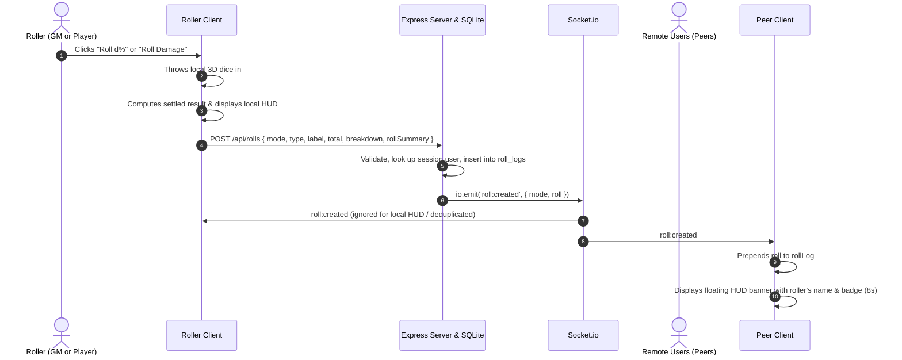

# Design Specification: Shared Dice Rolls and Roll Log

## Overview
Currently, dice rolls (3D dice animations, floating HUD banners, and Roll Log history) executed in the RPG VTT and Space VTT are purely local to the individual user's browser session. When a player or Game Master (GM) rolls, other connected users do not see the roll, and the Roll Log (`sf_vtt_rpg_roll_log` / `sf_vtt_space_roll_log`) is isolated to client `localStorage`.

This specification defines a synchronized dice roll and shared roll log system across all connected users (Players and GMs) using a REST API for durable session history and Socket.io for real-time broadcasts.

---

## Requirements & Scope

### 1. Functional Requirements
1. **Real-time Synchronization**:
   - When any user (GM or Player) makes a percentile (`d%`) or damage (`Nd10`) roll in either RPG VTT or Space VTT, all other connected users in that VTT mode receive real-time notification.
   - Connected peers see the floating Roll HUD banner appear with the roller's username, role badge, and roll details.
   - The roll is automatically prepended to the shared Roll Log HUD on all connected clients.
   - The 3D dice physics animation only executes on the screen of the user who initiated the roll.
2. **User Attribution**:
   - Every roll records and displays the roller's username and role (`GameMaster` or `Player`).
   - The floating HUD banner displays the roller's name and role badge (e.g. `[GM] ALICE — PERCENTILE ROLL: 42`).
   - Each item in the Roll Log displays the roller's username and role badge.
3. **Session History Persistence**:
   - Rolls are persisted on the server in SQLite so when a user refreshes the page, logs in, or reconnects, they immediately load the latest shared roll history.
   - Up to 20 recent rolls are displayed in the client Roll Log HUD.
4. **Scoping**:
   - RPG VTT and Space VTT maintain distinct, isolated roll logs (`mode = 'rpg'` vs `mode = 'space'`).
5. **Roll Log Clearing**:
   - Only Game Masters (`role = 'GameMaster'`) have permission to clear the shared roll log.
   - The "Clear" button in the Roll Log HUD is only visible/accessible to the GM.
   - Clearing the log deletes the mode's history on the server and emits a `roll:cleared` socket event, clearing the log for all connected clients in real time.

---

## Architecture & Data Flow



---

## Database Schema (`server/src/db.js`)

Add a new table `roll_logs` with index on `mode` and `created_at`:

```sql
CREATE TABLE IF NOT EXISTS roll_logs (
  id INTEGER PRIMARY KEY AUTOINCREMENT,
  mode TEXT NOT NULL CHECK(mode IN ('rpg', 'space')),
  user_id INTEGER NOT NULL,
  username TEXT NOT NULL,
  role TEXT NOT NULL,
  type TEXT NOT NULL CHECK(type IN ('percentile', 'damage')),
  label TEXT NOT NULL,
  total INTEGER NOT NULL,
  breakdown TEXT NOT NULL,
  roll_summary TEXT,
  created_at DATETIME DEFAULT CURRENT_TIMESTAMP
);

CREATE INDEX IF NOT EXISTS idx_roll_logs_mode_created ON roll_logs(mode, created_at DESC);
```

---

## Backend API Specification (`server/src/rolls.js`)

Mount router at `/api/rolls` with `db` and `io`: `app.use('/api/rolls', createRollRouter(db, io));`.

### 1. `GET /api/rolls`
- **Auth**: `requireAuth`
- **Query Parameters**:
  - `mode`: required, `'rpg'` or `'space'`
- **Response**: `200 OK`
  ```json
  [
    {
      "id": 12,
      "mode": "rpg",
      "userId": 2,
      "username": "wilks",
      "role": "Player",
      "type": "percentile",
      "label": "d%",
      "total": 42,
      "breakdown": "[Tens: 40, Ones: 2]",
      "rollSummary": { "total": 42, "tens": 4, "ones": 2, "valid": true },
      "timestamp": "14:22:05",
      "createdAt": "2026-10-16 14:22:05"
    }
  ]
  ```
  Returns at most 20 recent records in descending order of creation.

### 2. `POST /api/rolls`
- **Auth**: `requireAuth`
- **Body**:
  ```json
  {
    "mode": "rpg",
    "type": "percentile",
    "label": "d%",
    "total": 42,
    "breakdown": "[Tens: 40, Ones: 2]",
    "rollSummary": { "total": 42, "tens": 4, "ones": 2, "valid": true }
  }
  ```
- **Validation**:
  - `mode` must be `'rpg'` or `'space'`.
  - `type` must be `'percentile'` or `'damage'`.
  - `label`, `total`, and `breakdown` must be present and valid.
- **Behavior**:
  - Extracts `req.session.userId`, queries `users` table for current `username` and `role`.
  - Inserts row into `roll_logs`.
  - Prunes old rows: retains latest 100 rows per mode.
  - Emits Socket.io event:
    ```js
    io.emit('roll:created', {
      mode,
      roll: formattedRoll
    });
    ```
- **Response**: `201 Created` with `formattedRoll`.

### 3. `DELETE /api/rolls`
- **Auth**: `requireGM(db)`
- **Query Parameters**:
  - `mode`: required, `'rpg'` or `'space'`
- **Behavior**:
  - Deletes all rows in `roll_logs` where `mode = ?`.
  - Emits Socket.io event:
    ```js
    io.emit('roll:cleared', { mode });
    ```
- **Response**: `200 OK` `{ "success": true, "mode": "rpg" }`.

---

## Frontend Integration (`RpgVttView.vue` & `SpaceVttView.vue`)

### 1. State Management
- Replace `localStorage` loading (`loadRollLog` / `saveRollLog`) with server fetching and reactive socket updates:
  ```js
  const rollLog = ref([]);

  async function fetchRollLog() {
    try {
      const res = await fetch(`/api/rolls?mode=${currentMode}`, { credentials: 'include' });
      if (res.ok) {
        rollLog.value = await res.json();
      }
    } catch (err) {
      console.error('Failed to fetch roll log:', err);
    }
  }
  ```

### 2. Socket Handlers
In `setupSocketListeners()`:
```js
socket.on('roll:created', ({ mode, roll }) => {
  if (mode !== currentMode) return;

  // Prepend to roll log if not already present
  if (!rollLog.value.some(r => r.id === roll.id)) {
    rollLog.value.unshift(roll);
    if (rollLog.value.length > 20) {
      rollLog.value = rollLog.value.slice(0, 20);
    }
  }

  // If roll was made by another user, show the HUD banner for them
  if (roll.userId !== authStore.user?.id) {
    if (roll.type === 'percentile') {
      lastPercentileRoll.value = {
        ...roll.rollSummary,
        username: roll.username,
        role: roll.role,
        total: roll.total
      };
      showPercentileHud.value = true;
      if (percentileHudTimeout) clearTimeout(percentileHudTimeout);
      percentileHudTimeout = setTimeout(() => {
        showPercentileHud.value = false;
      }, 8000);
    } else if (roll.type === 'damage') {
      lastDamageRoll.value = {
        ...roll.rollSummary,
        username: roll.username,
        role: roll.role,
        total: roll.total
      };
      showDamageHud.value = true;
      if (damageHudTimeout) clearTimeout(damageHudTimeout);
      damageHudTimeout = setTimeout(() => {
        showDamageHud.value = false;
      }, 8000);
    }
  }
});

socket.on('roll:cleared', ({ mode }) => {
  if (mode === currentMode) {
    rollLog.value = [];
  }
});
```

In `cleanupSocketListeners()`:
```js
socket.off('roll:created');
socket.off('roll:cleared');
```

### 3. Rolling Dice (`rollPercentile` / `rollDamage`)
When the user rolls:
1. Physical 3D dice are rolled locally via `diceBoxInstance.roll(...)`.
2. Settled results are parsed.
3. Local HUD banner displays immediately with the user's own username and role badge.
4. Client sends `POST /api/rolls` with roll data.
5. On 201 response, if `rollLog` does not contain the returned `roll.id`, prepend it.

### 4. Roll Log HUD & Clear Button
- Render the roller's badge and name on each item in `ul.roll-log-list`:
  ```html
  <span class="roll-user-badge" :class="item.role.toLowerCase()">{{ item.username }}</span>
  ```
- Clear button:
  ```html
  <button
    v-if="isGm"
    type="button"
    class="btn-roll-log-clear"
    @click="clearRollLog"
    :disabled="rollLog.length === 0"
    title="Clear log"
  >Clear</button>
  ```
  `clearRollLog()` calls `DELETE /api/rolls?mode=${currentMode}`.

---

## Verification & Testing Plan
1. **Server Tests (`server/test/rolls.test.js`)**:
   - `GET /api/rolls`: requires auth, filters by mode, limits to 20 records.
   - `POST /api/rolls`: creates record with session user identity, validates payload, emits `roll:created`.
   - `DELETE /api/rolls`: rejects non-GM with 403, allows GM, deletes records, emits `roll:cleared`.
2. **Client Tests (`client/test/SharedRolls.test.js`)**:
   - Tests socket listener for `roll:created` adding entry to `rollLog` and displaying HUD for peer rolls.
   - Tests `roll:cleared` clearing `rollLog`.
   - Tests GM-only visibility of Clear button.
   - Tests user badge styling in Roll Log HUD.
3. **Full Suite Verification**:
   - `docker exec sf-vtt-dev bash -c "cd server && npm test"`
   - `docker exec sf-vtt-dev bash -c "cd client && npx vitest run && npm run build"`
