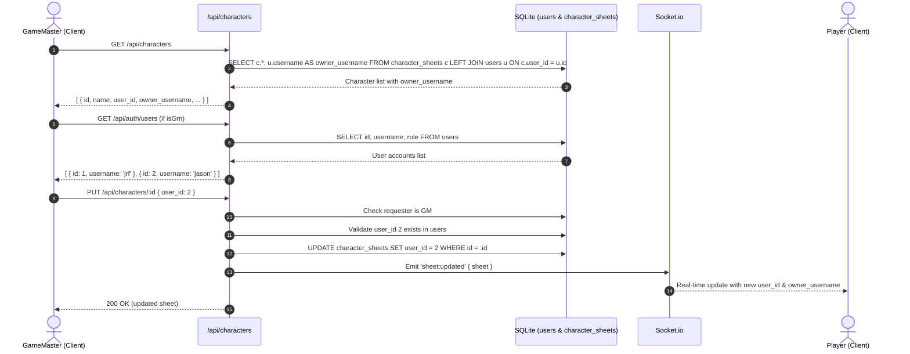

# Design: GM Character Sheet Player Assignment

**Date:** 2026-10-30  
**Status:** Approved  
**Goal:** Allow the GameMaster (GM) to assign any character sheet to a valid player login, both at creation time and by reassigning existing character sheets, while preserving existing behavior and permissions.

---

## 1. Problem & Context
Currently, each character sheet in `character_sheets` has a `user_id` column referencing `users(id)`, which sets sheet ownership. This `user_id` dictates token control permissions on maps (`token.character_id` checks `char.user_id === userId` for player movement) and sheet edit permissions for non-GMs. However:
1. `PUT /api/characters/:id` does not allow modifying `user_id`, meaning characters cannot be reassigned once created.
2. `POST /api/characters` hardcodes `req.session.userId` as the owner. If a GM creates a character sheet for a player, it remains owned by the GM.
3. The Character Sheets UI provides no way for the GM to view or change which player login owns a character.

---

## 2. Requirements & Scope
- **User Constraint:** "The GM should be able to assign a character sheet to a valid player login. Implement this but do not make any other changes, only add this capability."
- **GM Assignment:**
  - On the Character Sheet view, the GM can select any valid user account from a dropdown to assign or reassign the character sheet.
  - In the "Create New Character" modal, the GM can select which valid user account the new character should be assigned to (defaulting to the GM).
- **Player View:**
  - Non-GM players see a read-only badge indicating the assigned player (`owner_username`).
  - Non-GM players cannot reassign characters.
- **Security & Integrity:**
  - Only GameMasters (`isGameMaster`) can change `user_id` or assign a character to a different user.
  - If a non-GM supplies `user_id` in `PUT` or `POST`, it is ignored (defaulting to their own session user ID).
  - Assigned `user_id` must exist in `users`; invalid IDs return `400 Bad Request`.
  - Cascading deletes and token decoupling already handled via `FOREIGN KEY (user_id) REFERENCES users(id) ON DELETE CASCADE`.

---

## 3. Architecture & Data Flow



---

## 4. Detailed Component Design

### 4.1 Backend (`server/src/sheets.js`)

1. **`formatCharacterSheet(row)`**:
   Include `user_id: Number(row.user_id)` and `owner_username: row.owner_username || ''`.

2. **`GET /api/characters` and `GET /api/characters/:id`**:
   Update query to perform a `LEFT JOIN` on `users`:
   ```sql
   SELECT c.*, u.username AS owner_username
   FROM character_sheets c
   LEFT JOIN users u ON c.user_id = u.id
   ORDER BY c.sort_order ASC, c.id ASC
   ```

3. **`POST /api/characters`**:
   - Check if requester is GM via `isGameMaster(db, req.session.userId)`.
   - If GM and `req.body.user_id !== undefined`:
     - Validate: `const target = db.prepare('SELECT id, username FROM users WHERE id = ?').get(req.body.user_id);`
     - If not found: return `res.status(400).json({ error: 'Assigned user does not exist' })`.
     - Set target owner: `const ownerId = target.id;`
   - Otherwise (non-GM or omitted by GM):
     - `const ownerId = req.session.userId;`
   - Insert row using `ownerId`.

4. **`PUT /api/characters/:id`**:
   - Verify sheet exists and authorization (`isOwner || isGM`).
   - If `isGM && req.body.user_id !== undefined`:
     - Validate: `const target = db.prepare('SELECT id, username FROM users WHERE id = ?').get(req.body.user_id);`
     - If not found: return `res.status(400).json({ error: 'Assigned user does not exist' })`.
     - Update statement includes `user_id = ?`.
   - If not GM:
     - `user_id` remains unchanged (`existing.user_id`).
   - Fetch updated sheet with `LEFT JOIN users` and emit `sheet:updated`.

### 4.2 Frontend (`client/src/views/CharacterSheetsView.vue`)

1. **State & Lifecycle**:
   - Add reactive data property: `registeredUsers: []`.
   - In `mounted()`:
     ```js
     if (this.isGm) {
       this.fetchUsers();
     }
     ```
   - In `methods`:
     ```js
     async fetchUsers() {
       try {
         const res = await fetch('/api/auth/users', { credentials: 'include' });
         if (res.ok) {
           this.registeredUsers = await res.json();
         }
       } catch {
         this.registeredUsers = [];
       }
     }
     ```

2. **Sheet Header Controls (`.sheet-header .header-main`)**:
   - Positioned alongside Species and PSA controls:
     ```html
     <div v-if="isGm" class="player-select-wrap">
       <label>Player:</label>
       <select v-model="selectedChar.user_id" @change="updateCharacter" class="select-player">
         <option v-for="u in registeredUsers" :key="u.id" :value="u.id">
           {{ u.username }} ({{ u.role === 'GameMaster' ? 'GM' : 'Player' }})
         </option>
       </select>
     </div>
     <div v-else-if="selectedChar.owner_username" class="player-badge-wrap">
       <span class="badge-player" title="Assigned Player">
         👤 {{ selectedChar.owner_username }}
       </span>
     </div>
     ```

3. **Create Character Modal**:
   - When `isGm` is true, include:
     ```html
     <div v-if="isGm" class="form-group">
       <label>Assigned Player</label>
       <select v-model="newCharForm.user_id" class="char-create-select">
         <option v-for="u in registeredUsers" :key="u.id" :value="u.id">
           {{ u.username }} ({{ u.role === 'GameMaster' ? 'GM' : 'Player' }})
         </option>
       </select>
     </div>
     ```
   - In `initNewCharForm()` / `openCreateModal()`: default `newCharForm.user_id` to `authStore.user?.id`.

4. **Styling (`<style scoped>`)**:
   - Style `.player-select-wrap` and `.select-player` using sci-fi cyan theme matching `.select-race` and `.select-psa`.
   - Style `.badge-player` matching `.badge-tier` (`border: 1px solid rgba(69, 172, 186, 0.4); color: #45acba; background: rgba(69, 172, 186, 0.1); border-radius: 4px; padding: 4px 8px; font-size: 0.85rem;`).

---

## 5. Security & Verification

1. **Security**:
   - Role verification: `requireGM` or `isGameMaster(db, req.session.userId)` strictly guards player reassignment.
   - Non-GM players cannot assign characters to others or steal characters.
   - Input sanitization: `user_id` is parsed as integer and validated against the `users` table.

2. **Verification Checklist**:
   - `server/test/sheets.test.js`:
     - Test GM creating character assigned to another user ID.
     - Test GM reassigning existing character to another user ID.
     - Test rejecting invalid `user_id` with 400.
     - Test non-GM player cannot alter `user_id`.
     - Test `GET /api/characters` returns `owner_username`.
   - `client/test/CharacterSheetsView.test.js`:
     - Test GM sees player assignment select in header and create modal.
     - Test changing player select calls `updateCharacter` with new `user_id`.
     - Test non-GM player sees read-only badge.
   - Run complete Vitest suites (`client` & `server`).
   - Run production build and verify services.
