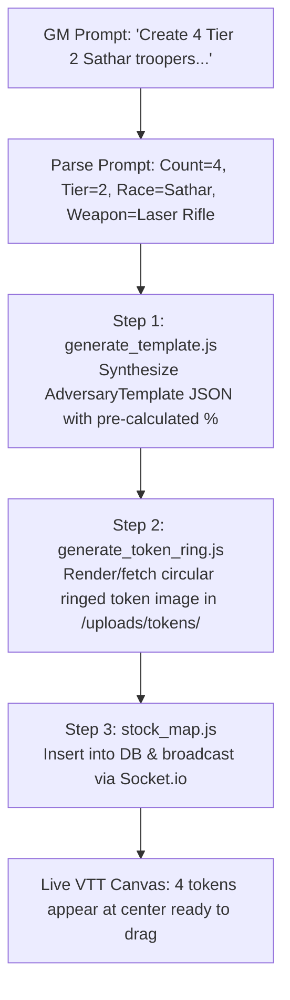

# Specification: Token Generation & Stocking Skill (`stock-encounter`)

## 1. Overview
The **Encounter Stocking Skill** enables Game Masters to populate tactical battle maps directly through conversational CLI commands during session preparation or live play. 

By executing natural language requests such as:
> *"Create 4 Tier 2 Sathar boarding troopers with laser rifles"*  
> *"Create 2 Tier 3 subterranean acid-spitting burrowers on the active map"*

The stocking pipeline automatically executes three coordinated steps:
1. **Rulebook-Accurate Template Synthesis:** Generates a valid `AdversaryTemplate` adhering to the Threat Tier scaling benchmarks with pre-calculated hit chances.
2. **Token Image Generation / Synthesis:** Produces or selects a high-contrast circular top-down/ringed token asset with transparency and stores it in `/uploads/tokens/`.
3. **Automated Canvas Instantiation:** Inserts $N$ distinct `TokenInstance` records (`#1` to `#N`) into the active map with collision-avoidant coordinates so they appear on the VTT canvas immediately in real time.

---

## 2. Skill Architecture (`.agents/skills/stock-encounter/`)

```
.agents/skills/stock-encounter/
├── SKILL.md                          # Main skill instructions and prompt parsing rules
├── scripts/
│   ├── generate_template.js          # CLI helper: synthesizes AdversaryTemplate JSON
│   ├── generate_token_ring.js        # Canvas/SVG helper: generates ringed token image asset
│   └── stock_map.js                  # Database/API helper: instantiates N tokens on active map
└── templates/
    ├── sentient_npc_archetypes.json   # Base stat presets for Human, Sathar, Vrusk, etc.
    └── creature_archetypes.json      # Base predator and beast chassis
```

---

## 3. Stocking Workflow Pipeline



### 3.1 Step 1: Template Synthesis (`generate_template.js`)
- **Input:** Count, Threat Tier (1–5), Category (`npc` vs `creature`), Archetype/Race, Loadout keywords.
- **Rule Resolution:**
  - Evaluates `specs/threat-tier-scaling.md` tables.
  - Determines Ability Scores: e.g. Tier 2 Sathar $\rightarrow$ `DEX 50, STR 50, STA 50, RS 50, IM +5`.
  - Determines Skill Levels: e.g. Tier 2 $\rightarrow$ Level 2 Combat Skill (`+20%`).
  - Pre-Calculates Actions:
    - Base chance: $\lceil 50 / 2 \rceil = 25\%$.
    - Skill bonus: $+20\%$.
    - Final target percentage: **`45%`**.
    - Damage: `Laser Rifle: 1d10 to 5d10 (1–5 SEU)`.
  - Determines Defenses: `Skein Suit (half kinetic damage)`.
- **Output:** Stored in `adversary_templates` table via REST API or direct DB connection.

### 3.2 Step 2: Token Image Asset Generation (`generate_token_ring.js`)
- Standardizes token art dimensions (256x256 px PNG with transparency).
- Features:
  - Outer border ring colored by Threat Tier:
    - Tier 1: `#2ecc71` (Emerald Green)
    - Tier 2: `#3498db` (Cobalt Blue)
    - Tier 3: `#9b59b6` (Amethyst Purple)
    - Tier 4: `#f1c40f` (Imperial Gold)
    - Tier 5: `#e74c3c` (Crimson Red)
  - Centered creature/NPC silhouette or stylized sci-fi portrait.
  - Clean drop shadow for map visibility across dark starfields, deserts, and metallic ship decks.
- Saved to: `/data/uploads/tokens/<slug>.png`, referenced in `token_image_path`.

### 3.3 Step 3: Instantiation & Placement (`stock_map.js`)
- Identifies currently active tactical map (`GET /api/maps/active?type=rpg`).
- Queries occupied grid cells `(x, y)` to avoid stacking.
- Uses existing concentric ring placement around the map center:
  - Token #1: `(centerX, centerY)`
  - Token #2..N: Adjacent open grid coordinates in spiral order.
- Generates numbered labels: e.g. `"Sathar Trooper #1"`, `"Sathar Trooper #2"`, `"Sathar Trooper #3"`, `"Sathar Trooper #4"`.
- Inserts records into `tokens` table with:
  - `template_id = "sathar-trooper-t2"`
  - `name = "Sathar Trooper #N"`
  - `current_hp = 50, max_hp = 50`
  - `seu_current = 50`
  - `conditions = "[]"`
  - `avatar_url = "/uploads/tokens/sathar-trooper-t2.png"`
- Emits Socket.io `token:created` event for each token. Connected GM and player browser windows display the tokens instantly without page reload.

---

## 4. D&D 5e SRD Fantasy Portability
To reuse this exact CLI skill in a D&D 5e VTT:
- The parser maps Threat Tier 1–5 to Challenge Ratings (e.g. CR 1/4 to CR 10+).
- The action builder outputs `+5 to hit` and `1d8+3` piercing instead of D100 percentile chances.
- The instantiation script (`stock_map.js`) and canvas rendering remain identical.
